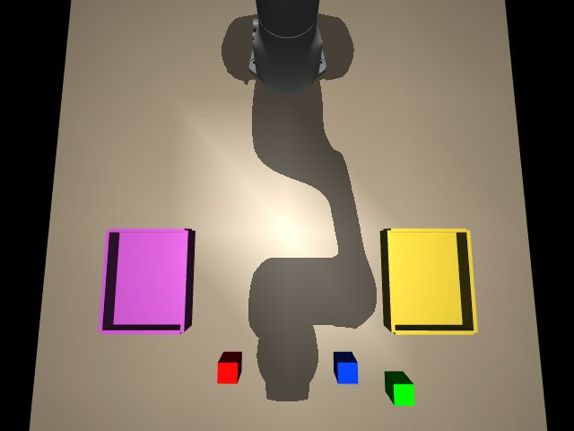

# 报告 010：Panda 实机联调完成，性能验收未全部通过

- **执行者**：Codex
- **日期**：2026-11-07（America/Los_Angeles；UTC 2026-11-08）
- **结果**：failed（测试已执行完毕，未放宽验收门槛）
- **分支 / PR**：`task-010-mujoco-loopback` / [草稿 PR #6](https://github.com/micsnq2yoma-lgtm/RV/pull/6)

## 一句话结论

Buildroot 的 FIFO80 实时控制环已驱动电脑 Panda 仿真，完成600秒联调、两相机返回及单独停止/重启测试；丢包率与RTT p99达标，但板端处理峰值超过200µs，PC运行中出现超过100ms的停顿/保持延迟，因此整体未通过。

## 逐步执行记录

| 步骤 | 结果 | 证据 |
|---|---|---|
| 前置 | 完成 | 基于008建分支，合并上游bea7027；用户本轮确认主电、USB、J1与伺服断电；bootstrap校时、固定IP/SSH已核对 |
| A1–2 | 完成 | 固定版本依赖与官方Panda下载脚本，资产忽略；原版执行器，桌面z=0，三方块两托盘及top/wrist相机 |
| A3–4 | 完成 | 本机fixture后在实际板子联调；长度/偏移与异常包测试通过；电脑主动UDP/TCP连接，没有改防火墙 |
| B5 | 完成 | Ubuntu gcc -O2 -Wall -Wextra无警告编译，readelf确认ELF64 little-endian RISC-V；复制至Buildroot /tmp，FIFO80、mlockall、CPU1全部成功 |
| B6 | 完成 | 板上Ubuntu Python客户端完成hello、objects、两render、reset seed=1、objects；仅打印元数据，不打印base64 |
| C7–8 | 已测，部分指标失败 | PC墙钟600.001801s，297401物理步，148700状态包；API和APT均已结束后才开始测量 |
| C9 | 完成 | 下方两图来自板上接收文件，经已认证SSH取回，区别于前期localhost图 |
| C10 | 已测 | 独立35s窗口中SIGINT原控制器、等待停止、停发2s后重启；与600s基准分开记录 |
| C11 | 完成 | [PC日志](../../logs/20261108-010-pc.log)、[板日志](../../logs/20261108-010-board.log)，保留失败及收尾记录 |

## 需要回答的问题

1. **版本？** MuJoCo4.0.0、numpy2.5.4、Pillow13.0.0；Menagerie `98a70c569c4c1b6da467a20012f766ee1f8dc521`，Panda Apache-2.0。原模型/网格不提交。
2. **实时速度及落后？** 297401步×2ms=594.802s物理进度，对应墙钟600.002s；落后事件200次。每事件是超过一个步长的迟到，不等于丢失步数；不追帧。reset会清零sim_time，不能把最终sim_time当总物理进度。持续测试有4次超时保持，见下方。
3. **10分钟统计？** PC有效RTT样本148699；p50=0.915500ms，p99=1.169200ms，最大=4.832900ms。超时未回应包0，丢包率0.000000%；另计reset丢弃1、结束在途0。板上收包148700、按seq丢包0；处理均值175.633µs、最大490.236µs；到达间隔均值4.055488ms、最大1665.939968ms、标准差5.763683ms。零序号丢包不代表250Hz一直实时：PC暂停发包时seq不跳号。
4. **运行位置/FIFO？** Ubuntu编译后，实际运行于Buildroot的/tmp/rv010-rt_ctl，不在chroot；运行输出SCHED_FIFO=80 mlockall=ok cpu=1。API/图片TCP客户端在Ubuntu；两者共用网络但不同进程。
5. **图片大小/传输耗时？**
   - top：19333 bytes，53.656721ms。
   - wrist：20767 bytes，11.758186ms。
   均640×480 JPEG质量80；耗时包含板上请求、PC渲染/编码和TCP接收，不能理解为纯链路时间。
6. **中断测试？** SIGINT后控制器继续mode=0约0.5秒再退出，重启后恢复mode=1。PC的超时检查记录如下（已经mode=0保持与真正超时分开）：

```json
[{"watchdog": "hold", "age_ms": 99.30489999896963, "already_holding": true}]
```
独立中断窗口累计实测关节1范围[-0.29635, 0.57839]rad，关节4范围[-1.87355, -1.03760]rad，夹爪总宽度[0.000000, 0.080010]m；这些是MuJoCo实际q，不仅是发送的目标。记录恢复事件和控制器退出码，见日志。
7. **协议问题？** 字段/长度/端口未变。建议维护者澄清reset/进程重启的seq语义、100ms硬保证与主机调度停顿的处理方式、JSON错误响应。当前错误响应带原id及error；不自行改v1。watchdog用98ms阈值留一个2ms步长余量，但不能阻止宿主机长停顿。

## 场景证据（实际传回板上）

已目视核对两张图，均能看到红、绿、蓝三个方块及两个托盘。




## 发现的问题与瓶颈证据

持续运行中的watchdog事件（最后有效指令到PC执行保持的实测间隔）：

```json
[{"watchdog": "hold", "age_ms": 1654.0643999996973, "already_holding": false}, {"watchdog": "hold", "age_ms": 1278.0516000002535, "already_holding": false}, {"watchdog": "hold", "age_ms": 149.4633000002068, "already_holding": false}, {"watchdog": "hold", "age_ms": 672.2036999999546, "already_holding": false}]
```
RTT p99与序号丢包满足要求，板端处理最大值不满足<200µs。PC也存在长步进/收包间隙，且保持触发延迟超过100ms，属于另一个未达标项；当前记录不足以区分GUI同步、Python调度、系统调度或驱动的具体责任，不把原因说死。未通过缩小样本、剔除峰值或改门槛报通过。

## 和任务单不一致的地方

- 初次真实板联调因GLFW并发初始化报Failed to register window class/could not create window，零收包，已停止所属RT进程并清理TCP客户端。改为先初始化viewer再启动离屏渲染线程，重新完整计时600秒；失败日志保留。
- Makefile增加显式配方，避免隐式规则把protocol.h也作为编译输入。Buildroot没有stat、Ubuntu没有file，分别改用Ubuntu stat和readelf，不额外安装工具。
- Pillow用于JPEG编码，已固定版本。腕部相机通过MjSpec附着原hand，不改原Panda资产。
- 独立中断窗口增加实际关节/夹爪范围诊断；600秒基准没有此附加字段，其控制逻辑相同。
- 前期本机18秒测试、离线x86-64编译曾用于准备，不能替代本次实机数据。README保留本机fixture的使用方式。

## 需要人做的事

无需追加现场操作。请维护者审阅未达标数据，决定是否安排PC步进停顿定位与板端处理尾延迟优化；未越过任务进入Agent、运动学或真实电机阶段。

## 收尾核对

- 所属 API、TCP 客户端及实时控制进程均已退出；`dpkg --audit` 无输出，Key 仅核对 owner=0 / mode=600。
- 维护者 `sh /mount_emmc.sh stop` 返回 Ubuntu unmounted；随后 status 和 `/proc/mounts` 再次确认全部卸载，串口返回码0。
- 隧道已关闭，板上127.0.0.1:7897监听消失；主机无所属SSH隧道进程，HTTPS正常。主机192.168.50.1/24保留，无有线DNS或默认网关，Clash仍只监听127.0.0.1:7897。
- 未执行修改主机Clash、防火墙或ICS的命令。收尾与较早008-r3快照比较发现路由差异及两条新增HNS DNS规则；该历史快照不能证明本轮前后完全一致，不擅自删除系统规则或恢复旧网络。具体生效时间/来源未确认。
- dmesg保留`[7110.054548] sched: RT throttling activated`；卸载时内核时间14924秒，该记录早于本次约600秒的联调窗口，不能据此归因当前峰值。
