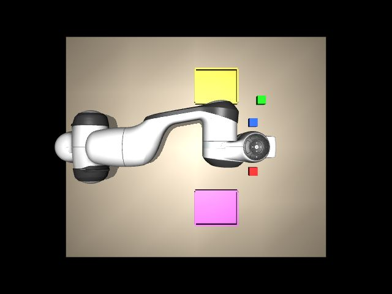
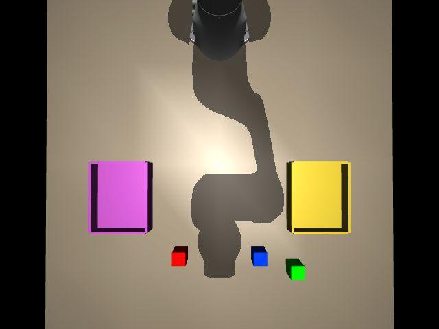

# 报告 010：Panda 本机回环完成，板上验收待执行

- **执行者**：Codex
- **日期**：2026-11-07（America/Los_Angeles；日志名按任务单 20261108）
- **结果**：blocked
- **分支 / PR**：`task-010-mujoco-loopback` / [草稿 PR #6](https://github.com/micsnq2yoma-lgtm/RV/pull/6)

## 一句话结论

电脑端场景、协议服务、板端 C/测试客户端已实现，本机 18 秒回环验证通过；尚未收到本轮现场确认，未操作开发板，不能宣称通过 10 分钟验收。

## 逐步执行记录

| 步骤 | 结果 | 证据 |
|---|---|---|
| 前置 | 完成 | 从 task-008-eth0-network 建分支，合并上游 bea7027；读取 DECISIONS、设计、任务单 |
| A1 | 完成 | 独立 .venv/010/py；版本固定；模型在忽略的 assets 中，许可证保留 |
| A2 | 完成（本机） | 原版 Panda 执行器，桌面 z=0，三方块两托盘；top/wrist 图见下方 |
| A3–4 | 本机验证 | [PC 日志](../../logs/20261108-010-pc.log)：hello、objects、两相机、reset；UDP 正弦命令与故意断包恢复；窗口模式运行，无防火墙改动 |
| B5 | 实现，待板上运行 | packed 144/80 字节断言，FIFO80、mlockall 失败即退出、CPU 绑定、限位、SIGINT 保持 0.5s；WSL x86-64 gcc -O2 -Wall -Wextra 编译无警告，不能替代 RISC-V 编译 |
| B6 | 本机协议验证 | Python 标准库 TCP 客户端依次请求并保存 JPEG、计算耗时 |
| C7–10 | 待人工前置 | 尚未收到本轮接线/伺服断电确认；未启动板上进程、未做 600 秒联调和 rt_ctl SIGINT/重启实测 |
| C11 | 当前报告 | 状态 blocked，提交草稿供审阅，不放宽验收标准 |

## 需要回答的问题

1. **MuJoCo / Menagerie 版本？** MuJoCo 4.0.0，numpy 2.5.4，Pillow 13.0.0；官方 Menagerie `98a70c569c4c1b6da467a20012f766ee1f8dc521`，Panda Apache-2.0。仅下载脚本入库。
2. **物理步进能否实时？落后次数？** 最终本机 18.000991 秒跑 8994 步，相当于 17.988 秒物理时间，接近实时；大于一步的落后计数 2。场景 reset 会清零 sim_time，所以不能直接用最终 sim_time 计算总步数。板上持续联调仍未知。
3. **十分钟指标？** 未执行，不提供替代数据。本机短测 RTT p50=0.177700 ms、p99=0.316670 ms、最大=0.593100 ms。发4497、有效回4371，故意停发0.5秒产生125个超时包，结束1包在途；损失率2.780249%包含故意中断，不能拿来评价正常网络丢包。板上处理时间和到达间隔抖动未测。
4. **Buildroot 还是 chroot？FIFO 成功吗？** 未确认。本轮 C 只做已有 WSL x86-64 编译，未运行其实时线程，更未验证板上 glibc 兼容性。
5. **图像大小和耗时？** 本机 TCP：top 19638 bytes / 53.5745 ms；wrist 18894 bytes / 4.4906 ms，均640×480 JPEG质量80。耗时包括请求、渲染、编码与传输；不是板上百兆网口的传输成绩。
6. **中断结果？** 本机 fake_board 故意停发0.5秒，PC 在最后有效指令后99.807 ms记录保持，随后恢复收包。板上 Ctrl+C → 连续0.5秒mode=0 → 停止 → 重启尚未测试。
7. **协议需修改？** 字段、端口、长度保持v1。建议维护者澄清：seq重启/回绕与reset的统计口径、100ms是到达超时还是包括调度延迟、JSON错误响应格式。实现当前使用同id扁平响应、额外error字段；reset-discard和在途另计。未自行修改设计文档。

## 场景证据（本机，不是板上传回）

两视图均可见三色方块和两托盘。初版布局存在遮挡，已调整；腕部相机通过 MjSpec 附着原hand，未改原模型资产。实体位置是否适合后续抓取需后续任务验证。

## 和任务单不一致的地方

- 新增 Pillow 用于 JPEG 编码；requirements 已固定版本。
- 板上前置待确认，因此先做本机 fixture 和已有 WSL 离线编译；没有用这些结果冒充上板。
- watchdog用98ms阈值留一个2ms步长余量，目标在100ms内生效；Windows调度仍无硬实时保证。首次迭代在物理线程取收包时间导致p99约2.6ms，改成独立UDP到达时间戳后才取得上述结果。
- 首轮两个进程不同权限环境下无应答，改为同一获准本机环境后成功；随后修复模拟端正常结束时fixture收到Windows UDP reset而异常退出的问题。最终两进程均返回0。
- 初次 pip 访问本机配置的PyPI镜像出现TLS EOF，重试后成功；未改证书校验或主机网络。API读取Menagerie提交也遇EOF，改用只读git ls-remote成功。

## 发现的问题和风险

短测不是10分钟稳定性保证；尚不能确认板上处理最大值<200µs或p99<2ms。TCP测试客户端完成六请求后主动关闭，PC按两秒重连，日志中随后的TimeoutError不影响已完成的UDP短测或图像返回。渲染单独线程，快照复制短暂加锁；Python/Windows可能有调度抖动。

## 需要人做的事

确认本轮主电、调试USB、J1网线就绪，伺服动力电断开或电机未连接，并说明是否重启。之后继续板上编译、FIFO权限检查、600秒联调、两相机实传及中断恢复，更新本PR。
