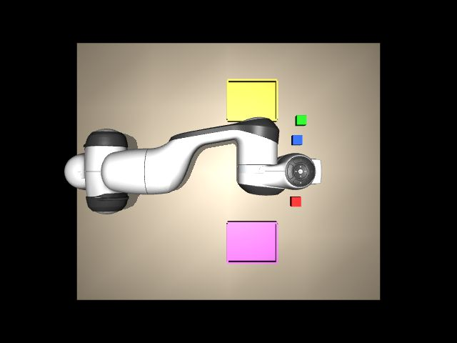
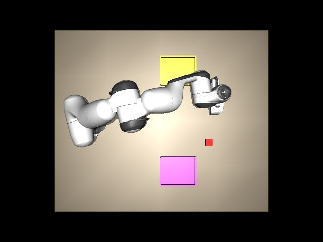
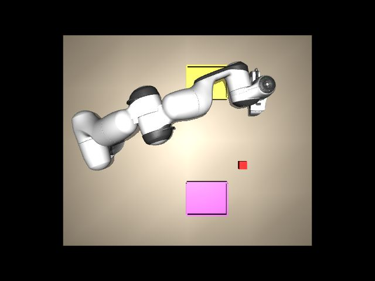

# 报告 011：Panda 运动学、轨迹和抓放实测

- **执行者**：Codex
- **日期**：2026-11-07–08（America/Los_Angeles；UTC 2026-11-08）
- **结果**：failed
- **分支 / PR**：`task-011-pick-place` / 待填写

## 一句话结论

基于任务010分支并合并上游3c706ed，完成协议v1.1、显示/渲染进程隔离、板上FK/IK与五次轨迹接口。托盘任务9/10、堆叠10/10；两次整板失联导致600秒复测未完成，整体failed。以下区分模型校验、执行器跟踪和实时调度数据。

## 逐步执行记录

| 步骤 | 结果 | 证据 |
|---|---|---|
| 前置 | 完成 | 用户本轮确认主电、USB、J1、伺服断电且未重启；重新枚举COM3、检查已有主机.50.1/24并执行bootstrap |
| A1–2 | 完成 | 三组各180秒，事件记录>20ms的步进、窗口同步、TCP及UDP间隔；[计时日志](../../logs/20261108-011-timing.log) |
| A3–4 | 失败（十分钟未完成） | 默认隔离显示/渲染、物理进程HIGH、1ms定时器；600秒目标的复测因再次板级失联而中断；小序号重启、98ms分类、错误应答不改原UDP格式 |
| B5–7 | 完成 | 从mjModel导出链，TCP site在hand局部z=0.1014m；板上50组FK与30点IK；[运动学日志](../../logs/20261108-011-kinematics.log) |
| C8–9 | 完成 | Unix数据报替换轨迹/查询/取消；五次关节插补、线性夹爪，Python平均速度≤0.5rad/s；错误包及中途替换连续性实测 |
| D10–11 | 完成 | home/move_to/pick/place；只用objects真值；没有改方块质量、摩擦或托盘尺寸 |
| E12–13 | 功能指标达标，图片有遮挡 | 两项分别种子0–9各10次，不替换失败样本；[抓放日志](../../logs/20261108-011-skills.log)；正式关键帧有遮挡，后续补拍图片在复位后为0字节 |
| E14 | 完成 | 源码、README、日志、报告、STATUS与PR |

## 需要回答的问题

### 1. 卡顿位置、修复和修复后指标

旧架构对照：A与C的viewer.sync本来就均≤30Hz，因此C主要隔离“不调用render”的差异；A/B每5秒请求一次俯视渲染，C每5秒ping。三组均运行180秒。

| 配置 | 看门狗触发 | 板上到包间隔最大 ms | 板上处理最大 µs |
|---|---:|---:|---:|
| a-window | 2 | 583.507064 | 535.869 |
| b-headless | 2 | 118.839135 | 631.614 |
| c-window-no-render | 0 | 89.323935 | 532.145 |

A的viewer.sync实测最长578.007ms，紧接约580ms的步进/UDP间隙；确认窗口同步是一个阻塞来源。B无窗口仍有约107.558ms的mj_step调用及118ms间隙，C也有84ms级mj_step调用。单凭墙钟计时不能进一步区分MuJoCo计算、GIL重获、OS停调或驱动；不宣称已找到唯一底层根因。诊断期曾并行准备代码、编译及安装尾段，因此不以三组板端微秒数据作为最终验收。

修复把viewer、OpenGL和TCP移到单独NORMAL优先级进程，物理/UDP使用HIGH（没有REALTIME），共享快照发布不等待锁，初始化图形后再开始计时。保留30Hz显示与timeBeginPeriod(1)。由观察到的阻塞点指导隔离；最终十分钟没有并行安装、编译或本机测试夹具。默认PC配置中，板上timing_client每5秒下发4秒五次轨迹段并请求一张top图，持续验证真实插补及渲染负载；不是只测空闲控制器。

- 计划连续600秒，但本次窗口仅运行 **24.362446s** 即中断，不能作为十分钟验收；物理步 **12175**，落后事件 **1**；不追帧。
- 看门狗总数 **1**，其中仿真停顿 **0**、正常调度下指令静默 **1**。
- 板上到包间隔最大 **18.100392ms**（门槛<50ms），均值4.026387ms，标准差0.410869ms。
- PC RTT p50 **0.967500ms**，p99 **1.218310ms**，最大2.648200ms；丢包率58.578027%。丢包分母包括板子失联后、监督停止前继续发送的状态包；板端间隔和处理统计仅覆盖最后收到的2272包累计行，不能覆盖失联后的时间。
- 98ms检查每步执行；只在本步起点间隔也≥98ms时归为仿真停顿，否则归指令静默。这是观测分类，不是证明网口或CPU根因。

### 2. FK误差、IK收敛率及耗时

50组关节角均匀取自完整限位，随机种子11；每段遵守平均速度限值，完成后再等1秒。用同一ee_pose应答里的**实际q**计算板上FK，与该应答的MuJoCo TCP世界位姿比较：位置最大 **1.294731e-15m**，姿态最大 **1.001916e-13度**。这是两个数学模型的浮点一致性，不是实际机器人定位精度。

随机姿态会发生自碰撞/碰桌，最大命令跟踪偏差 **2.512743rad**；逐组保留goal与actual_q，不能说50个指令姿态都被执行器准确到达。

30个工作区目标（x∈[0.45,0.70]、y∈[-0.25,0.25]、z∈[0.025,0.25]m，夹爪向下）收敛 **30/30**，板上平均 **1.644716s**。每个结果仍按<1mm、<1°、最多200次验收，不返回未收敛解。

### 3. 轨迹接口与板端处理时间

[README](../../sim_agent/README.md#trajectory-interface)定义80字节RVT1请求与144字节RVR1应答，本地Unix数据报路径/tmp/rt_ctl.sock；不影响原UDP的144/80字节格式。op1替换、op2查询、op3取消；每段从当前q_des出发，五次插补，完成后保持端点。新段/取消/对端重置更新generation。Python计算duration≥0.5s且平均关节速度≤0.5rad/s；五次插补峰值是平均值的1.875倍，未把平均限速当峰值限速。

C在Ubuntu中编译并运行，FIFO80、mlockall、CPU1成功；L2仅在CPU0。这使两个进程看到相同的Unix套接字路径。中断前最后收到的板端累计行：处理均值 **171.966µs**、最大 **445.547µs**，与<1ms门槛比较。该短窗口已实际下发3个轨迹段并启动插补，未完成600秒，不能据此宣告实时验收通过；每轮抓放的处理统计另见skills日志。

### 4. 两项成功率、耗时与失败原因

| 任务 | 成功 | 有耗时样本均值秒 | 耗时样本数 | 失败原因分布 |
|---|---:|---:|---:|---|
| 1 | 9/10 | 18.348810 | 9/10 | {"board serial/SSH/UDP unresponsive during placement; no trial result returned; counted as failure without retry": 1} |
| 2 | 10/10 | 18.397323 | 10/10 | {} |

任务1判据为红块中心xy在托盘内并留半块边长，z在(0.02,0.05)m。任务2判据为蓝绿xy距离<2cm且高度差0.04±0.01m；放置后等1秒再取真值。日志保留已返回的最终objects、抓取宽度及错误原因。任务1种子8在板级失联时未返回结束记录，按失败计入分母，耗时无法确定；均值只用其余有完整计时的样本。恢复后只补跑尚未开始的种子9，未重跑种子8。各run的trial编号从0开始，跨run按(task,seed)唯一汇总。S3直接使用真值，不接视觉或DeepSeek。

### 5. 场景参数改动

没有修改原版Panda、执行器、块质量/摩擦或托盘尺寸。只在我们自己的加载代码给hand增加TCP site，偏移由编译后指尖碰撞垫端点减1cm算出（0.1014m），以及沿用原有wrist相机。未添加吸附、焊接、对象瞬移或隐藏抓取约束。

## 堆叠关键帧

以下是正式堆叠测试种子0的三张俯视关键帧，已在第二次失联前下载到电脑。机械臂遮住了抓取和堆叠位置，因此图片不能单独证明堆叠成功；成功率依据objects真值日志。

正式测试后另做了一次种子0补拍，排除在成功率之外。该次日志报告退回home后仍堆叠成功，但第二次整板失联复位后，eMMC上四张补拍JPEG均为0字节，下载校验失败，未当作有效图片提交。未确认数据未落盘的具体原因；此前图片写入没有显式fsync。保留文件大小和恢复日志，不再运行控制测试补拍。

## 板级中断与恢复

任务1前8个种子成功。种子8放置过程中，板端RT/Python输出及UDP同时中断，主机仿真仍正常步进；其后串口命令20秒无应答、SSH/ARP不通。主机.50.1/24与100Mbps物理链路仍在，未修改网络设置。没有捕获崩溃前内核栈，不能断定是固件、驱动、供电还是用户程序触发。

用户确认主电灯亮并短按RESET；启动恢复到登录。因系统此前完全不响应，无法正常卸载eMMC，复位后正常挂载发生EXT4 journal recovery，随后dpkg --audit无输出、numpy可用。新启动SSH公钥通过物理串口重新固定；只删除确认无所有者的旧任务Unix套接字。后续持续只读采集串口，并增加15秒RT日志停止的监督超时。[恢复证据](../../logs/20261108-011-recovery.log)。该中断属于整板失联，不能算成已经修复的PC卡顿。

恢复后补完未测试的种子并执行补拍。随后十分钟目标复测在开始约10秒时再次失去板上UDP/SSH输出，15秒无RT日志触发监督停止，PC窗口总计约24.36秒；连续串口采集未捕获异常栈，主动串口检查再次无响应。用户第二次RESET后仅进行取证和正常卸载，不再运行控制测试。因此整体验收failed，未把多个短窗口拼接成10分钟，也未宣称板级失联已解决。

最终恢复期间，串口首次重开被Windows拒绝、SSH初次连接/握手超时；只读核对服务和链路后重试成功，没有再次RESET或修改主机网络。第二次eMMC挂载也报告journal recovery；dpkg --audit无输出。SSH中断时返回-1不是控制进程正常退出码，失败运行没有被改写为干净退出。

## 和任务单不一致的地方与开发失败

- C与L2同在Ubuntu运行，CPU1/CPU0隔离；没有改主机网络、Clash或防火墙。
- numpy安装监督在180秒超时，随后确认dpkg installed、numpy1.26.4可导入；未重复安装。实际新增numpy与BLAS/LAPACK/Fortran依赖共4包，未升级或删除。
- 首次单次测试因Buildroot缺taskset及Win32句柄类型错误停止；改用Python进程自身affinity和正确HANDLE原型。随后监督stdin线程提前启动会使Windows派生进程初始化超时；把stdin读取移到派生进程就绪后，才完成单次双任务验证。保留[开发日志](../../logs/20261108-011-development.log)。
- mode=0改为进入保持时锁定位置，避免每包重抓“当前位置”导致随重力缓慢漂移。图形初始化同步完成再开始计时；这不删除运行期卡顿样本。
- FK明确按实测q校验模型，另记随机碰撞姿态的命令跟踪偏差。任务未实现碰撞规避，不把它用于真实电机。

## 验证与收尾

最初4项协议/运动学单元测试通过；本机对端序号回退测试通过；板上错误Unix包、轨迹替换连续性和未知TCP操作错误应答测试通过。收尾代码审查发现非对象JSON请求可能使TCP线程退出，补充错误回复边界并新增3项本机测试，最终7项全部通过。该最后的JSON健壮性改动没有重新上板运行，实测计时对应此前版本，物理/UDP路径未改。日志提供原始统计，公开副本仅脱敏身份/主机路径；认证和SSH公钥记录未纳入公开副本，全部原始文件保存在忽略目录.venv/011。

所有所属测试进程退出，Ubuntu正常stop并通过/proc/mounts确认全部卸载，SSH隧道关闭；主机固定IP保留且HTTPS正常。收尾证据见[setup日志](../../logs/20261108-011-setup.log)。本任务没有读取DeepSeek Key。

## 需要人做的事

请维护者优先审阅两次板级失联，安排内核/驱动/固件或实时进程交互的进一步定位；当前没有足够证据区分责任。功能指标达到9/10与10/10，但稳定性仍未验收。请评审测量范围、剩余限制和后续任务；本次没有推进S4或真实电机阶段。
